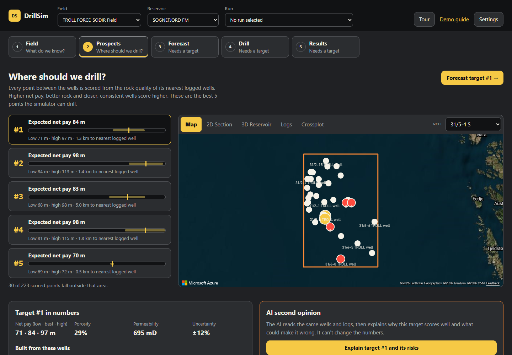
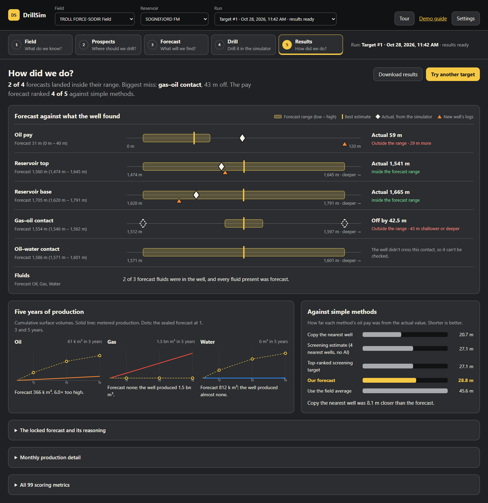

# DrillSim

DrillSim is an independent .NET 10 and Aspire monorepo built from the
MIT-licensed drilling microservices originally published by the
[Open Source Drilling Community (OSDC)](https://github.com/Open-Source-Drilling-Community).
It brings the services and Cluster web application into one solution that can
be built, launched, observed, and managed together.

> [!IMPORTANT]
> This repository is maintained independently by Zachary Way. It is not
> maintained by, affiliated with, or endorsed by OSDC.

## What is included

- 20 drilling service APIs, a .NET analysis API, a five-step React
  web app, and the Cluster Blazor web application
- .NET Aspire orchestration, service discovery, health checks, and telemetry
- A persistent Aspire-managed SQLite database for each service
- OpenAPI documents with Scalar API reference pages
- Model Context Protocol (MCP) endpoints

## See the workflow

DrillSim is a synthetic decision-support demo. The web app at
`http://localhost:5173` walks through five steps, each answering one question:

1. **Field — What do we know?** Well counts, wells with rock-quality logs,
   average net pay and the area the simulator can drill, with Map, 2D Section,
   3D Reservoir, Logs and Crossplot views.
2. **Prospects — Where should we drill?** The five best drillable targets with
   low / best / high net-pay ranges on a map, plus what the reservoir model holds
   at each (gas and oil thickness). **Looking for** (Any / Oil / Gas) re-ranks by
   that fluid's pay; the forecast and the score follow it. **AI second opinion** returns a
   cited brief on why the target looks good and what could make it wrong
   (about 50 seconds).
3. **Forecast — What will we find?** Creates a run for the target. **Draft
   forecast with AI** fills net pay, reservoir top and base depth, total depth,
   fluids and production (60–120 seconds). The AI starts from the screening net
   pay and must cite evidence for any change; the screening value stays in the
   prediction binding and is scored as a baseline. **Fill from reservoir model**
   fills the form from the reservoir model without AI. Edit anything, then **Lock forecast** to seal and approve it in
   one step.
4. **Drill — Drill it in the simulator.** **Drill this well** runs the blind
   simulator end to end: load the hidden model, drill, survey, sample, log,
   complete, produce for five years, publish and score. Failures are explained
   in plain language.
5. **Results — How did we do?** The forecast against the new well's logs, the
   hidden truth and simple rules of thumb, plus five years of simulated production
   in surface m³ (continuous flow at 15 MPa bottom-hole pressure, capped at 4,320
   reservoir m³/day, generic volume factors); all metrics are in an appendix.

[](docs/screenshots/redesign-prospects.png)

[](docs/screenshots/redesign-results.png)

Net pay is a rock-quality proxy (thickness passing porosity and permeability
cutoffs), not reserves, and the P90/P50/P10 ranges are uncalibrated. The
simulator's hidden truth never reaches the browser or the AI, and the AI never
changes numbers or saves anything without the user. Customer implementations
need a real geoscientist.

The [demo guide](docs/index.html) has the step-by-step walkthrough, a
10-minute demo script, troubleshooting and the architecture. See
[Preflight & datasets](docs/index.html#preflight) for local setup, dataset
imports, simulator model preparation and reset.

## Prerequisites

- [.NET SDK 10.0.400](https://dotnet.microsoft.com/download/dotnet/10.0)
  or a compatible .NET 10 feature-band SDK
- [Aspire CLI 13.5.3](https://aspire.dev/get-started/install-cli/) or newer
- Node.js 22.12+ or 24 LTS with npm, and PowerShell 7 for the commands below
- Azure CLI and a development subscription with resource-creation and
  role-assignment permissions, plus access and quota for the configured model
- Python 3.10+ for sample-data imports

## Get started

```powershell
git clone git@github.com:seiggy/drillsim.git
Set-Location .\drillsim

dotnet restore .\DrillSim.slnx
dotnet build .\DrillSim.slnx --no-restore
npm ci --prefix .\src\DrillSim.AnalysisWeb
aspire certs trust
az login
aspire run
```

On first launch, answer Aspire's Azure setup prompts for any missing tenant,
subscription, resource group and location settings. Aspire creates Azure Maps,
Foundry and the model deployment, configures access and passes their connection
information to the Analysis API. The rest of the application stays local.
Provisioning can take several minutes and creates billable Azure resources;
later launches reuse the saved setup. See [Azure dependencies](#azure-dependencies)
for existing resources, model options and an offline mode.

If you use AzEnv, initialize the intended profile before `az login` and `aspire run`.
Otherwise, Azure CLI's default profile works without additional configuration.

Open the Aspire dashboard URL printed by `aspire run`. The dashboard provides
the dynamically assigned endpoints for the Cluster UI, service APIs, logs,
traces, health status, and SQLite resources.

Stop the application with:

```powershell
aspire stop
```

SQLite files are persisted under `data\` and are excluded from source control.
After the first setup, `aspire start` can launch the app in the background.
Stopping the AppHost or resetting local data does not delete its Azure resources.

## Validation

Use Release outputs while Aspire runs Debug resources:

```powershell
dotnet test .\DrillSim.slnx -c Release --nologo
.\scripts\test_service_contracts.ps1
```

The solution includes AppHost parameter tests, the Analysis API, Drilling Operations, and Reservoir
Simulation test projects; it does not include every legacy test project.
The second command runs twelve additional self-contained service-contract
projects, including in-process Earth-service HTTP/MCP tests, isolated controller
tests, and explicitly selected local fixtures from mixed test projects. Their
test frameworks and MCP client contracts match the .NET 10 services.

Legacy REST/MCP fixtures hardcoded to `localhost:5001` or `localhost:8080` are
not run by this command: some mutate their target service. Do not point them at
the seeded application or an unrelated local app. Model and unit-conversion
library tests are separate from both commands. Passing these suites does not
establish calibration accuracy or complete live distributed-system coverage.

## Service endpoints

Ports are assigned at launch. Open a service from the Aspire dashboard, then
use these paths:

| Path | Purpose |
| --- | --- |
| `/swagger` | Scalar API reference |
| `/swagger/v1/swagger.json` | Generated OpenAPI document |
| `/health` | Readiness health check |
| `/alive` | Liveness health check |
| `/mcp` | MCP HTTP transport, where implemented |
| `/mcp/ws` | MCP WebSocket compatibility transport, where implemented |

The AppHost advertises implemented public HTTP MCP endpoints at their service
base paths. Discover and exercise them through Aspire:

```powershell
aspire mcp tools --non-interactive
aspire mcp call field ping --input '{}' --non-interactive
```

Geological Properties, Trajectory, Drilling Fluid, Geothermal Properties, and
YPL Calibration currently use REST rather than HTTP MCP. Some other services
advertise connectivity-only tools; discovery does not imply complete CRUD tool
coverage. Hidden Reservoir Simulation and internal Drilling Operations are
intentionally not advertised as public MCP servers.

## Analysis workstation

The `analysis-web` resource is the React app. Aspire exposes it at the stable
development origin `http://localhost:5173`, which Azure Maps CORS allows. The
ranking, forecast form, simulator and results work without a model connection.

### Using the app

The header holds **Field**, **Reservoir** and **Run** menus, plus **Tour**,
**Demo guide** and **Settings**. The Field menu lists original datasets; the Run
menu lists earlier runs for that field, such as "Target #1 · Oct 27, 2026,
2:05 PM", with a plain status (*forecast in progress*, *drilling*, *drilling
failed*, *results ready*). Choosing a run opens the step it reached. Forecast,
Drill and Results show *Needs a target* until a run exists.

Only targets inside the prepared simulator model's area are listed on
Prospects, and Forecast refuses a total depth deeper than the model, so a well
can no longer be planned outside simulator coverage from the UI.

**Settings** holds every adjustable value, stored in the browser:

| Setting | Default |
| --- | --- |
| Minimum porosity | 12% |
| Minimum permeability | 1 mD |
| Wells used per target (inverse-distance neighbours) | 4 |
| Keep-away distance from existing wells | 500 m |
| Grid points per side | 15 (225 points) |
| Simulator model detail | Preview (Standard is finer and slower) |
| Approve the completion design automatically | On |
| Your name or initials (recorded on lock and drill) | Demo analyst |
| Hide automated test runs | On |

Saving analysis settings re-scores every target; runs already started keep the
settings they were locked with. **Tour** opens a side panel with the purpose,
what to do and what to look for on each step. It only navigates.

### Demo guide

Open **Demo guide** in the app, or [`docs/index.html`](docs/index.html)
directly. The same page is the repository's GitHub Pages site, published by the
Pages workflow from `main` (select **GitHub Actions** under **Settings → Pages →
Build and deployment**). Pages serves the guide, not the running simulator.

### AI agents

The analysis agents run locally in the Analysis API on Microsoft Agent
Framework and call the Azure AI Foundry deployment through the Responses API.
Each reads one verified evidence snapshot through read-only tools, checks its
answer with a validation tool, and may cite only evidence those tools returned.
None can save, approve, drill or reveal anything. Response storage and
background execution are disabled.

| Agent | Endpoint | Used by the UI |
| --- | --- | --- |
| Prospect brief | `POST /api/prospect-briefs` | Prospects → **AI second opinion** |
| Forecast draft | `POST /api/forecast-drafts` | Forecast → **Draft forecast with AI** |
| Formation interpretation | `POST /api/formation-interpretation` | No (server-side only) |
| AG-UI field and scenario notes | `/agui`, `/agui/scenario` | No (server-side only) |
| Ask DrillSim assistant | `/agui/assistant`, `GET /api/assistant/status` | Header → **Ask DrillSim** |

The prospect brief returns a verdict (*Worth drilling*, *Drill with caution* or
*Not yet — check first*), a headline, reasons, rated risks and checks, each
citing the wells it is based on. It must answer *Not yet* for a target outside
simulator coverage. The forecast agent calls a deterministic tool that
interpolates the reservoir top and base at the target from nearby picks
(inverse distance, survey-converted where stations exist), reviews logs and
screening, and drafts total depth, fluids, contacts, production, assumptions and
reasoning; a `validate_forecast` tool checks it before it answers. The target
and expected net pay stay deterministic, and the user still edits and locks the
forecast.

The formation-interpretation agent and the field and scenario AG-UI endpoints
remain available server-side for API clients, but the redesigned UI no longer
calls them.

#### Ask DrillSim assistant

The chat panel is a [Vercel AI SDK](https://ai-sdk.dev) `useChat` client
(`src/DrillSim.AnalysisWeb/src/components/AssistantPanel.tsx`) talking AG-UI to
`/agui/assistant` through a small transport (`assistantTransport.ts`). Each
screen publishes what it shows with `useAssistantContext(id, description,
value)`; those items travel as AG-UI `context`, and `AssistantPageContext`
prepends them to the latest user message because the AG-UI host does not
forward context to the model.

The agent runs on the GitHub Copilot harness
(`Microsoft.Agents.AI.GitHub.Copilot`) with bring-your-own-key: model calls go
to the same Azure OpenAI deployment using an `AzureCliCredential` bearer token,
so no GitHub Copilot sign-in is used. The harness is sandboxed: built-in tools
(shell, files, web, sub-agents), config discovery and plugins are off, and the
permission handler approves only DrillSim's own tools. To extend it:

- **Tools** — add an `AIFunction` in `DrillSimAssistant.CreateTools`
  (`src/DrillSim.AnalysisApi/Services/DrillSimAssistant.cs`); it is allowed
  automatically. Keep tools read-only. Give it a plain label in `toolLabels`
  in `AssistantPanel.tsx`.
- **Skills** — add `src/DrillSim.AnalysisApi/AssistantSkills/<name>/SKILL.md`
  (copied to the output on build). The starter `drillsim-glossary` skill
  explains DrillSim terms in plain language.

Answers can include rich content, and none of it is rendered as HTML:

- **Tables** — markdown pipe tables, parsed by the panel's own small markdown
  renderer into React elements (numeric columns right-aligned, at most 60 rows).
  Any HTML the model writes shows as plain text.
- **Charts** — the `show_chart` tool (bar, line or scatter; up to 6 series of
  100 points). The server validates the arguments and returns problems so the
  model can retry; the browser validates them again (`parseChartSpec` in
  `AssistantChart.tsx`) and draws its own SVG with a **Show data** table.
  Series named gas, oil or water use the app's fluid colours. To add another
  visual, add a display-only tool and render its `dynamic-tool` part in
  `MessageBody`.

The first question after the Analysis API starts takes up to about a minute
while the Copilot runtime starts a session; later answers take 5–30 seconds.
Ask one warm-up question before a demo.

AI availability reports configuration, not model capacity. A provider 429 is
shown as "The AI service is at capacity"; nothing is retried automatically.
Failures log `ProspectBriefFailure` (event 8320), `ForecastDraftFailure` (8310)
or `FormationInterpretationFailure` (8300) in Aspire's `analysis-api`
structured logs, with the original exception and `ProviderStatusCode`,
correlated with the request trace. Browser errors remain sanitized.

Agent `invoke_agent` spans contain a child model span. In **Development**, both
capture input and output messages, including field evidence; treat trace
exports accordingly. Message capture is off outside Development. Agents start
from a small brief (at most 8 KiB) and fetch more through tools within
runaway-execution limits (128 tool calls, 2 MiB of retrieved data, 10-minute
deadline). Cancellation is available, and provider failures are not retried.

Frontend checks use the existing runner:

```powershell
Set-Location .\src\DrillSim.AnalysisWeb
npm run build
npm run test:forecast-ai
# Optional browser checks using an already installed Playwright module:
$env:DRILLSIM_PLAYWRIGHT_MODULE = "<absolute-path-to-playwright>\index.mjs"
npm run test:guide:browser
```

Aspire automatically generates missing internal service keys and persists them
in the AppHost's user-secrets store. Existing values are reused; neither a
restart nor a dataset reset requires generating new keys.

### Azure dependencies

The AppHost uses `Aspire.Hosting.Foundry` to provision an Entra-only Foundry
account and the `drillsim-chat` model deployment. Its custom
[`azure-maps.bicep`](aspire/DrillSim.AppHost/Infrastructure/azure-maps.bicep)
module provisions an Entra-only Azure Maps account with CORS for
`http://localhost:5173`. Aspire assigns **Cognitive Services OpenAI User** and
**Azure Maps Data Reader** to the local developer identity at their respective
account scopes. No keys, endpoint copying or manual role assignments are needed
for newly provisioned resources.

The defaults are `eastus2`, a resource group prefix of `rg-drillsim`, and
`gpt-6-astra` version `2026-09-03`, using GlobalStandard capacity `100`.
Use an Azure subscription and region with the required model access and quota;
Aspire cannot grant either. Standard `Azure:SubscriptionId`, `Azure:TenantId`,
`Azure:ResourceGroup` and `Azure:Location` settings control the deployment target.
Local provisioning uses `Azure:CredentialSource=AzureCli`, matching the Analysis API.

To change the managed model, set `AzureResources:ModelName` and
`AzureResources:ModelVersion` together in the AppHost's user-secrets store.
`AzureResources:ModelCapacity` controls deployment capacity. The replacement
must support structured responses, the Responses API and function tools;
there is no automatic model substitution.

**Existing connections are preserved.** Complete groups of the following
AppHost parameters bypass provisioning for that service independently:

| Connection | Required `Parameters:` values |
| --- | --- |
| AI | `azure-openai-endpoint`, `azure-openai-deployment-name`, `azure-openai-subscription-id` |
| Maps | `azure-maps-client-id`, `azure-maps-tenant-id`, `azure-maps-subscription-id` |

The AI endpoint must end in `/openai/v1/`. Maps needs the account's client ID,
not a subscription key or app-registration ID. Existing resources must already
have the corresponding data-plane roles and Maps CORS setting; the AppHost does
not change externally configured accounts. Partial groups fail with an
explanatory error. Remove a complete group to switch that service to Aspire
provisioning on the next launch.

**Without Azure**, disable new provisioning before startup:

```powershell
dotnet user-secrets set "AzureResources:Provision" "false" --project .\aspire\DrillSim.AppHost
```

Complete existing connections are still used. Without them, Maps and AI are
unavailable, but the portal's deterministic analysis and local simulator work.
Set the value to `true` to enable provisioning again.

Azure authentication uses `AzureCliCredential`. An existing `AZURE_CONFIG_DIR`
is forwarded to the Analysis API; otherwise the AppHost uses the default
`.azure` directory under the user's home. Credentials are never sent to the
browser. The API brokers short-lived Azure Maps tokens for
`https://atlas.microsoft.com/.default`. A Maps 403 after token acquisition calls
for checking the account client ID and its Data Reader assignment.

### Internal simulation access

The reservoir-simulation operator key is generated when missing and is not referenced by the
analysis API or browser. Drilling Operations is internal-only and receives the
Stage A operator key plus its own internal and future Analysis API callback
credentials; none are forwarded to the browser.

Before S2 generates a drilling path, it registers the approved **Planned** path
with the reservoir service. A path outside the prepared model's coverage is
rejected before drilling or survey artifacts are created. S4 still checks the
**AsDrilled** path, because steering can leave the model even when the plan fits.
The Drill step explains the failure in plain language and points back to
Prospects, which lists only targets inside the model's area. Changing the seed
or Preview/Standard resolution does not expand that area; existing approved
paths and failed runs are not rewritten.

In Aspire, the reservoir service logs `ReservoirRequestRejected` (event 8400)
with the HTTP status, diagnostic code and field-by-field validation errors on
the failing request trace. Malformed requests log `ReservoirRequestMalformed`
(8401) with the parse exception. Browser failure messages use known diagnostic
codes rather than forwarding private model details or arbitrary backend text.
Older runs recorded only as `StageADataMismatch` retain that original code;
their missing validation detail cannot be recovered from the old trace.

Two repair actions remain on the local operator facade
(`/api/operator/scenarios/{id}/runs/{runId}/...`) but have no button in the
redesigned UI. `recover-publication` re-attempts an uncommitted S8 publication
rejected by a destination service after the import problem is fixed; it
requires acknowledging the exact staged-plan hash and preserves the same run
and plan. `correct-score` appends a corrected, versioned scorecard for the
historical absolute-error-bound defect without changing the rejected artifact,
inputs or point scores. Neither repeats drilling or publication, and an
uncertain response must be retried with its saved action key. Labels are audit
annotations, not authenticated identities. Architecture and geology cleanup
retain every publication-marked record regardless of its simulation date.

The hidden reservoir service conditions deterministic structured worlds from
logged controls and runs an adaptive immiscible oil/water/gas IMPES kernel. Its
cell truth remains in service memory. An operator can seed the Troll-Sognefjord
world without exposing that truth to the analysis agent:

```powershell
$env:RESERVOIR_SIMULATION_OPERATOR_KEY = "<same operator key>"
python .\scripts\seed_reservoir_world.py
```

## Services

| Aspire resource | Source project |
| --- | --- |
| `cartographic-projection` | CartographicProjection |
| `analysis-api` | DrillSim.AnalysisApi |
| `analysis-web` | DrillSim.AnalysisWeb |
| `cluster` | Cluster |
| `cluster-ui` | Cluster WebApp |
| `drilling-operations` | Internal checkpointed drilling workflow |
| `drilling-fluid` | DrillingFluid |
| `drill-string` | DrillString |
| `earth-gravity` | EarthGravity |
| `earth-magnetic-field` | EarthMagneticField |
| `earth-vertical-datum` | EarthVerticalDatum |
| `field` | Field |
| `geodetic-datum` | GeodeticDatum |
| `geological-properties` | GeologicalProperties |
| `geothermal-properties` | GeothermalProperties |
| `rig` | Rig |
| `reservoir-simulation` | ReservoirSimulation hidden ground-truth service |
| `simulator-4ndof` | Simulator4nDOF |
| `survey-instrument` | SurveyInstrument |
| `trajectory` | Trajectory |
| `unit-conversion` | UnitConversion |
| `well` | Well |
| `well-bore` | WellBore |
| `well-bore-architecture` | WellBoreArchitecture |
| `ypl-calibration` | YPLCalibrationFromRheometer |

## Repository layout

| Path | Contents |
| --- | --- |
| `aspire\DrillSim.AppHost` | Aspire application topology and service wiring |
| `aspire\DrillSim.ServiceDefaults` | Shared telemetry, health, discovery, and resilience configuration |
| `src` | Ported service, model, UI, and supporting projects |
| `data` | Local SQLite databases created at runtime |

## Attribution and license

The projects under `src\` are derived from software published by OSDC under the
MIT License. Their original copyright and license notices remain applicable to
the imported code and its original contributors.

This repository and its independently authored changes are licensed under the
[MIT License](LICENSE), copyright (c) 2026 Zachary Way.
